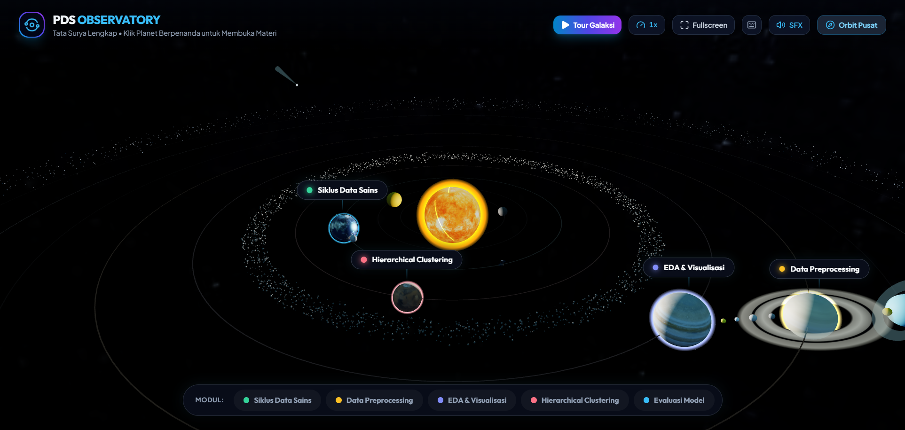
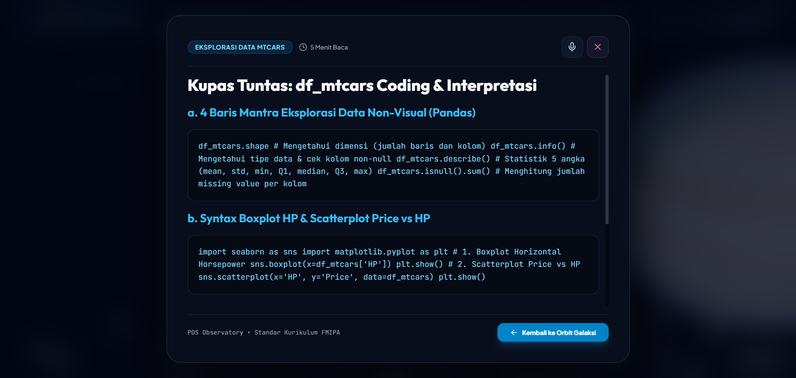

# 🪐 PDS 3D Astronomical Observatory — Interactive Data Science Universe

[](https://threejs.org/)
[](https://www.khronos.org/webgl/)
[](https://tailwindcss.com/)
[](https://greensock.com/gsap/)
[](https://katex.org/)

An immersive, photorealistic 3D Solar System and interactive Data Science learning hub built with **Three.js**, **WebGL**, **Web Audio API**, and **Tailwind CSS**. 

Explore the planets and delve into interactive data science modules—from missing value handling and clustering algorithms to machine learning model evaluation metrics.

---

## 🌟 Preview Showcase



*Panoramic interactive 3D solar system featuring 10 celestial bodies, an asteroid belt of 2,200+ tumbling rocks, a distant Kuiper belt, and real-time planetary orbits.*



*Holographic study reader equipped with high-legibility typography, KaTeX LaTeX formulas, interactive simulation labs, and integrated Indonesian Text-to-Speech (TTS).*

---

## 🚀 Key Features

### 🌌 1. Photorealistic 3D Astronomical Simulation
* **10 Celestial Bodies:** Mercury, Venus, Earth (with clouds & Moon), Mars, Jupiter (with 4 Galilean Moons: Io, Europa, Ganymede, Callisto), Saturn (photorealistic polar UV rings & Titan), Uranus (tilted vertical ring), Neptune, and Pluto.
* **Massive Instanced Asteroid Belts:** 
  * **Main Asteroid Belt:** Over 2,200 dynamically tumbling 3D rock asteroids orbiting between Mars and Jupiter.
  * **Outer Kuiper Belt:** 2,600 icy comet nuclei encircling the solar perimeter.
* **Dynamic Space Phenomena:** Periodic streaking comets with additive-blended glowing ion tails, animated solar prominence plasma flares on the Sun, orbital research probes, and shooting stars.
* **Zero External Network Lag:** All planet and star textures are pre-processed and optimized into Base64 Data URIs, guaranteeing 0ms instant loading and zero CORS issues on local `file:///` and static hosts.

### 📊 2. Comprehensive Data Science Curriculum
Clicking on tagged study planets smoothly activates a cinematic camera warp that docks onto the celestial body and reveals complete, curriculum-aligned data science masterclasses:
1. **Bumi (Earth) — Siklus Hidup Data Sains:** Understanding the CRISP-DM methodology, business understanding, data acquisition, modeling, and operationalization.
2. **Saturnus (Saturn) — Data Preprocessing & Outliers:** Practical strategies for handling missing values (imputation vs drop), outlier detection, log transformation, and Min-Max vs Z-Score standardization.
3. **Jupiter — EDA & Visualisasi:** Pandas non-visual analysis (`shape`, `info`, `describe`, `isnull`) and Seaborn exploratory charts (boxplots, scatterplots, correlation matrices).
4. **Mars — Hierarchical Clustering:** Hierarchical Agglomerative Clustering (HAC), single vs complete vs average linkage, distance matrices, and dendrogram interpretation.
5. **Neptunus (Neptune) — Evaluasi Model Klasifikasi:** Confusion Matrix metrics (Accuracy, Precision, Recall, F1-Score, Specificity), Type I vs Type II errors, and trade-offs.

### 🎧 3. Multi-Sensory Experience & Accessibility
* **Procedural Web Audio Engine:** Custom synthesizer generating harmonic UI click chimes, spatial camera warp swooshes, and interactive feedback without external audio files.
* **Built-in Text-to-Speech (TTS):** Native browser speech synthesis engine reads study materials aloud in Indonesian (`id-ID`).
* **Eye-Friendly Night Palette:** Muted obsidian luxury tones (`#02040a` / `#0b101c`) and soft sky-blue accents designed for strain-free late-night studying.

---

## 🛠️ Tech Stack & Libraries
* **3D Engine:** [Three.js r128](https://threejs.org/) (PerspectiveCamera, MeshStandardMaterial, InstancedMesh, OrbitControls)
* **Animation & Camera Tweens:** [GSAP 3.12](https://greensock.com/gsap/)
* **Typography & UI:** [Tailwind CSS CDN](https://tailwindcss.com/) & [Outfit Font](https://fonts.google.com/specimen/Outfit)
* **Mathematical Typography:** [KaTeX](https://katex.org/) (Auto-render extension)
* **Icons:** [Lucide Icons](https://lucide.dev/)
* **Audio:** Web Audio API & Web Speech Synthesis API

---

## 📦 How to Deploy on GitHub Pages (in 2 Minutes)

Deploying this project is 100% free and takes less than 2 minutes since it requires **no backend or build step**:

### Step 1: Create a New GitHub Repository
1. Go to [github.com/new](https://github.com/new).
2. Set the repository name to `pds-solar-observatory` (or any name you like).
3. Set visibility to **Public** and leave other options unchecked.
4. Click **Create repository**.

### Step 2: Push the Files
Open terminal or PowerShell in this directory (`deploy_pds_observatory`):

```bash
git init
git add .
git commit -m "feat: initial release of PDS 3D Solar Observatory"
git branch -M main
git remote add origin https://github.com/YOUR_GITHUB_USERNAME/pds-solar-observatory.git
git push -u origin main
```

### Step 3: Enable GitHub Pages
1. Go to your repository on GitHub.
2. Click **Settings** $\to$ **Pages** (in the left sidebar).
3. Under **Branch**, select `main` and `/ (root)`.
4. Click **Save**.

Your 3D Universe will be live within 60 seconds at:
```
https://YOUR_GITHUB_USERNAME.github.io/pds-solar-observatory/
```

---

## 👨‍💻 Author
**Fahreza Kautsar**  
*Data Science & Analytics Enthusiast*  
* GitHub: [@fahrezakautsar9-cpu](https://github.com/fahrezakautsar9-cpu)
